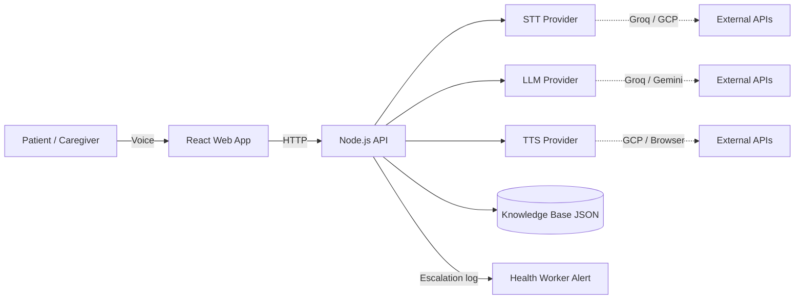
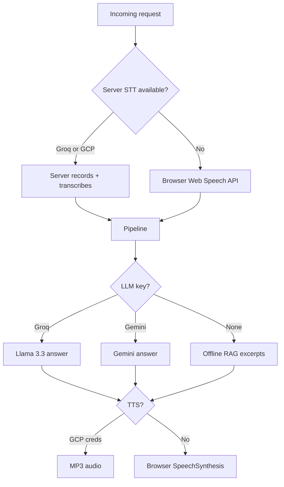

# High-Level Design (HLD) — VDA Assistant

## 1. Problem Statement

Rural NCD (Non-Communicable Disease) patients in India often cannot read. They need a **voice-first** assistant that can:

- Answer questions about medicines, follow-ups, and lifestyle (UC1)
- Explain government health schemes like PM-JAY (UC2)
- Help find nearby public health facilities (UC3)
- Guide mild symptoms and teleconsultation (UC4)
- **Never miss** emergency red flags (chest pain, breathlessness, stroke)

The system must work in **multiple Indian languages** (Hindi, Gujarati, English, Hinglish, etc.) on low-end smartphones with unreliable networks.

---

## 2. System Context



**Actors:**
- **Patient** — speaks, listens; no reading required
- **VDA Frontend** — records audio, plays response, shows minimal UI
- **VDA Backend** — orchestrates pipeline, enforces safety
- **External providers** — Groq (free STT/LLM), GCP (STT/TTS), Gemini (LLM)
- **Knowledge base** — curated JSON documents per use case (RAG source)

---

## 3. Core Design Principles

| Principle | What it means in VDA |
|-----------|----------------------|
| **Safety first** | Red-flag detection runs **before** intent classification and LLM |
| **No diagnosis** | Assistant navigates care; never prescribes or diagnoses |
| **Grounded answers** | LLM answers only from retrieved knowledge chunks (RAG) |
| **Fail safe** | Low STT confidence → fallback; unknown intent → out-of-scope |
| **Privacy by default** | No transcript storage; sessions expire in 30 minutes |
| **Rural-ready** | Free-tier providers, browser fallbacks, multilingual support |

---

## 4. Logical Architecture (Layers)

```mermaid
flowchart TB
    subgraph Presentation["Presentation Layer"]
        Mic[Voice Button]
        Lang[Language Selector]
        Resp[Response + Replay]
    end

    subgraph API["API Layer (Express)"]
        Health[/health]
        Session[/api/voice/session]
        Process[/api/voice/process]
        Text[/api/voice/text]
    end

    subgraph Pipeline["Pipeline Layer"]
        STT2[Speech-to-Text]
        LangDet[Language Detection]
        Safety[Safety Gate]
        Intent[Intent Classifier]
        RAG[RAG Retrieval]
        LLM2[Answer Generation]
        TTS2[Text-to-Speech]
    end

    subgraph Data["Data Layer"]
        KB2[Knowledge JSON x4]
        Sess[In-Memory Sessions]
    end

    Mic --> Process
    Mic --> Text
    Process --> STT2 --> LangDet --> Safety
    Text --> LangDet --> Safety
    Safety -->|escalate| Resp
    Safety -->|ok| Intent
    Intent -->|out of scope| Resp
    Intent -->|matched| RAG --> LLM2 --> TTS2 --> Resp
    RAG --> KB2
    Session --> Sess
```

---

## 5. Request Flow (Two Paths)

### Path A — Server STT (recommended)

```
Hold mic → Record WebM → POST /api/voice/process
  → Validate audio (min 2 sec)
  → Groq Whisper / GCP STT
  → Pipeline (safety → intent → RAG → LLM)
  → Response JSON + optional GCP audio
  → Browser plays audio or TTS
```

### Path B — Browser STT (fallback)

```
Tap mic → Web Speech API transcribes locally
  → POST /api/voice/text { text }
  → Same pipeline (no server STT)
  → Browser TTS for response
```

---

## 6. Use Case Mapping

| UC | Domain | Knowledge File | Example Question |
|----|--------|----------------|------------------|
| **UC1** | NCD adherence | `adherence.json` | "मुझे दवा कब लेनी है?" |
| **UC2** | PM-JAY scheme | `pmjay.json` | "Am I eligible for Ayushman Bharat?" |
| **UC3** | Facility linkage | `facilities.json` | "नजदीकी hospital कहाँ है?" |
| **UC4** | Teleconsult / triage | `triage.json` | "Doctor से बात करनी है" |

**Emergency** is not a separate UC — it is handled by the **Safety Gate** and returns `type: escalation` before any use-case routing.

---

## 7. Response Types

| Type | When | User hears |
|------|------|------------|
| `answer` | Valid intent + RAG context found | Grounded health navigation answer |
| `escalation` | Red-flag symptom detected | "Call 108 immediately…" |
| `out_of_scope` | Intent confidence too low | "I can only help with medicines, schemes, hospitals…" |
| `fallback` | Empty or low-confidence STT | "I didn't understand. Please speak again." |

---

## 8. Provider Strategy (High Level)



**Demo recommendation:** Groq API key only — free STT + LLM, browser TTS.

---

## 9. Deployment View (Conceptual)

```
┌─────────────────────────────────────────┐
│  User phone / browser (localhost:5173)  │
│  React + Vite + Tailwind                │
└──────────────────┬──────────────────────┘
                   │ HTTPS (prod) / proxy (dev)
┌──────────────────▼──────────────────────┐
│  Node.js API (port 3001)                │
│  Express + TypeScript                   │
│  ├─ Pipeline services                   │
│  └─ knowledge/*.json (bundled)          │
└──────────────────┬──────────────────────┘
                   │
     ┌─────────────┼─────────────┐
     ▼             ▼             ▼
  Groq API    Google Cloud    Gemini API
  (STT+LLM)   (STT+TTS)       (LLM)
```

**Production additions (not in demo):** reverse proxy, rate limiter, Redis sessions, monitoring, clinician webhook for escalations.

---

## 10. Non-Functional Requirements

| NFR | Target | Current implementation |
|-----|--------|------------------------|
| Latency | < 5s end-to-end | Depends on Groq/GCP; browser STT is faster |
| Safety recall | 100% on known red flags | Regex patterns in `safety.ts` |
| Privacy | No PII retention | In-memory sessions, 30-min TTL |
| Availability | Graceful degradation | Browser STT/TTS fallbacks |
| Multilingual | 10 languages UI | Script-based detection + keyword intent |
| Cost | Free-tier demo | Groq + browser; GCP optional |

---

## 11. What Is Out of Scope (Product)

- Medical diagnosis or prescription
- Storing patient health records
- Real-time clinician dashboard (escalation is console log stub)
- Multi-turn conversational memory (each turn is largely stateless)
- Embedding-based semantic search (uses keyword RAG for simplicity)

---

## 12. Related Documents

| Document | Purpose |
|----------|---------|
| [LLD.md](./LLD.md) | Component-level design, APIs, data structures |
| [HOW-IT-WORKS.md](./HOW-IT-WORKS.md) | Simple walkthrough for interview demo |
| [TRADE-OFFS.md](./TRADE-OFFS.md) | Design decisions and alternatives |
| [INTERVIEW-QUESTIONS.md](./INTERVIEW-QUESTIONS.md) | Likely Q&A for Medtronic interview |
| [OPERATIONS-AND-EDGE-CASES.md](./OPERATIONS-AND-EDGE-CASES.md) | Rate limits, errors, out-of-scope handling |
