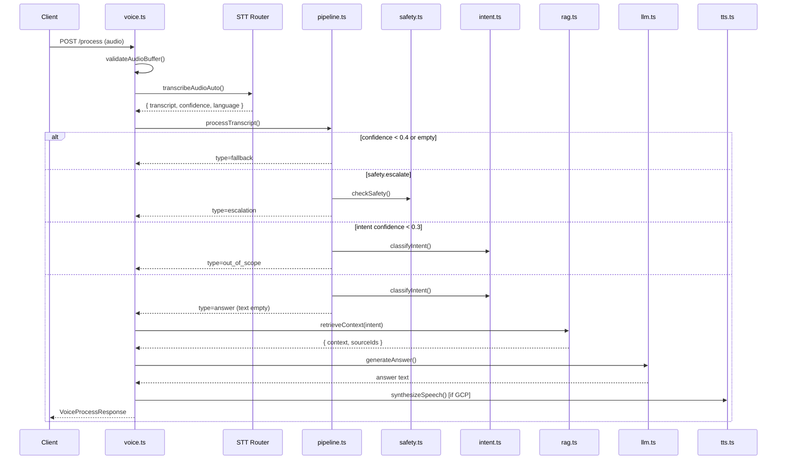
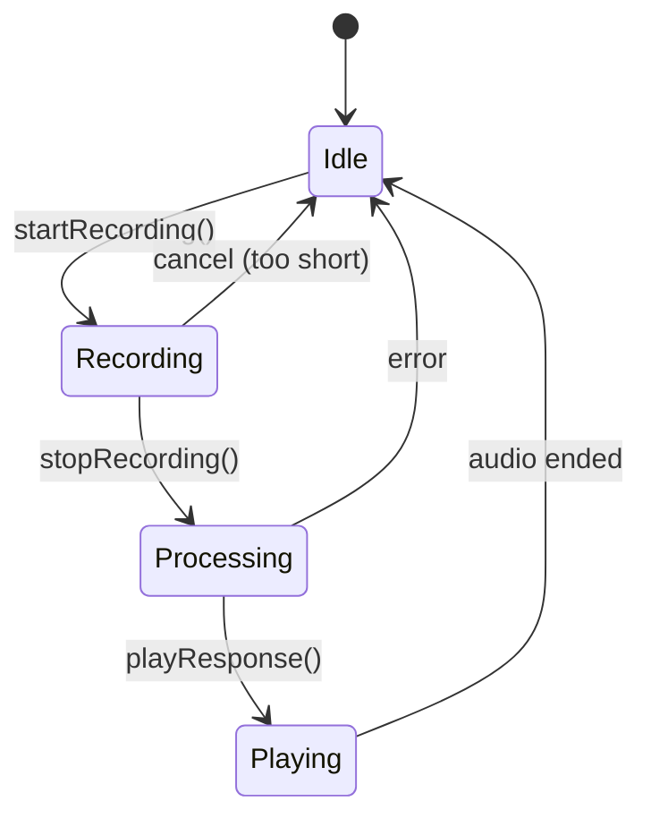

# Low-Level Design (LLD) — VDA Assistant

## 1. Module Map

```
backend/src/
├── index.ts              # Express app, /health, CORS
├── types.ts              # Shared TypeScript types
├── routes/voice.ts       # HTTP endpoints
├── services/
│   ├── pipeline.ts       # Orchestrator
│   ├── safety.ts         # Red-flag regex gate
│   ├── intent.ts         # Keyword intent classifier
│   ├── rag.ts            # Knowledge retrieval + LLM wrapper
│   ├── llm.ts            # Groq / Gemini answer generation
│   ├── language.ts       # Script-based language detection
│   ├── stt-router.ts     # STT provider routing
│   ├── stt.ts            # GCP Speech-to-Text
│   ├── stt-groq.ts       # Groq Whisper
│   ├── tts.ts            # GCP Text-to-Speech
│   ├── session.ts        # In-memory session store
│   ├── audio-utils.ts    # Audio validation
│   ├── gcp.ts            # GCP credential checks
│   └── groq.ts           # Groq client singleton
└── knowledge/            # RAG source files
    ├── adherence.json    # UC1
    ├── pmjay.json        # UC2
    ├── facilities.json   # UC3
    └── triage.json       # UC4

frontend/src/
├── App.tsx               # Main UI shell
├── hooks/useVoiceSession.ts  # Client orchestration
├── components/
│   ├── VoiceButton.tsx   # Hold-to-speak / tap-to-toggle
│   ├── LanguageSelector.tsx
│   └── ResponseDisplay.tsx
└── utils/
    ├── audioRecorder.ts  # MediaRecorder with timeslice
    └── browserSpeech.ts  # Web Speech API STT/TTS
```

---

## 2. API Contract

### `GET /health`

Returns provider availability so frontend can choose recording mode.

```json
{
  "status": "ok",
  "groq": true,
  "gemini": false,
  "gcpCredentials": false,
  "voiceMode": "groq",
  "capabilities": {
    "serverStt": true,
    "stt": "groq",
    "llm": "groq",
    "tts": "browser"
  }
}
```

### `POST /api/voice/session`

Creates session. Returns `{ "sessionId": "uuid" }`.

### `POST /api/voice/process` (multipart)

| Field | Type | Required | Description |
|-------|------|----------|-------------|
| `audio` | file | yes | WebM/Opus recording |
| `languageCode` | string | no | `auto` or BCP-47 (`hi-IN`, `gu-IN`, …) |
| `sessionId` | string | no | Reuse or auto-create |

**Validation (`audio-utils.ts`):**
- Minimum 2000 bytes
- WebM magic bytes `0x1A 0x45 0xDF 0xA3` or WAV `RIFF`

**Error responses:**

| Status | Code | Meaning |
|--------|------|---------|
| 400 | `AUDIO_TOO_SHORT` | Recording < 2 seconds |
| 503 | — | No server STT configured |
| 500 | — | Groq/GCP failure |

### `POST /api/voice/text` (JSON)

```json
{
  "text": "मुझे दवा कब लेनी है?",
  "sessionId": "optional-uuid",
  "languageCode": "auto",
  "skipTts": false
}
```

### Response: `VoiceProcessResponse`

```typescript
interface VoiceProcessResponse {
  type: 'answer' | 'fallback' | 'escalation' | 'out_of_scope';
  text: string;           // Answer or message to speak
  audio: string;          // Base64 MP3 (empty if browser TTS)
  sessionId: string;
  transcript?: string;
  intent?: 'UC1' | 'UC2' | 'UC3' | 'UC4';
  reason?: string;        // Safety reason e.g. cardiac_symptoms
  sources?: string[];     // RAG chunk IDs used
  ttsMode?: 'gcp' | 'browser';
  responseLang?: string;  // e.g. hi-IN
  sttProvider?: 'gcp' | 'groq';
}
```

---

## 3. Pipeline Sequence (Detailed)



### Thresholds

| Check | Threshold | File |
|-------|-----------|------|
| STT fallback | confidence < 0.4 OR empty text | `pipeline.ts` |
| Intent out-of-scope | confidence < 0.3 | `intent.ts` |
| Min recording | 1500ms frontend, 2000 bytes backend | `audioRecorder.ts`, `audio-utils.ts` |
| Session TTL | 30 minutes | `session.ts` |

---

## 4. Safety Gate (`safety.ts`)

**Runs before intent and LLM.** Deterministic regex only.

| Category | Example patterns | Action |
|----------|------------------|--------|
| Cardiac | chest pain, सीने में दर्द, છાતીમાં દુખાવ | `CALL_108_IMMEDIATELY` |
| Respiratory | can't breathe, सांस लेने में, શ્વાસ લેવામાં | `CALL_108_IMMEDIATELY` |
| Stroke | sudden weakness, बोल नहीं पा रहा | `CALL_108_IMMEDIATELY` |
| Neurological | severe sudden headache | `CALL_108_IMMEDIATELY` |
| LOC | unconscious, बेहोश | `CALL_108_IMMEDIATELY` |
| Bleeding | heavy bleed, खून बह रहा | `CALL_108_IMMEDIATELY` |

**On escalation:**
1. `alertClinician(sessionId, reason, transcript)` — logs to console (stub)
2. Returns fixed escalation message in detected language
3. **No LLM call** — model cannot soften the message

---

## 5. Intent Classifier (`intent.ts`)

**Algorithm:** Keyword scoring across 4 use-case rule sets.

```
For each UC rule:
  score = count of matching keywords in transcript
Pick highest score → useCase
confidence = topScore / totalScore (capped at 0.95)
If score == 0 → regional health heuristic OR confidence 0
If confidence < 0.3 → out_of_scope
```

**Special cases:**
- Out-of-scope keywords (weather, cricket) → force confidence 0
- Regional symptom + question patterns → UC4 even without English keywords

**Intent label mapping (for tests):**

| Test label | Use case |
|------------|----------|
| MEDICATION_SCHEDULE | UC1 |
| FOLLOW_UP | UC1 |
| SCHEME_ELIGIBILITY | UC2 |
| FIND_HEALTH_CENTER | UC3 |
| EMERGENCY | Safety gate (not intent) |
| TELECONSULTATION | UC4 |

---

## 6. RAG Retrieval (`rag.ts`)

### Knowledge chunk schema

```typescript
interface KnowledgeChunk {
  id: string;        // "uc1-med-schedule"
  topic: string;     // "medication_schedule"
  keywords: string[]; // multilingual
  content: string;   // English facts for LLM context
}
```

### Scoring algorithm

```
For each chunk in use-case index:
  score = 0
  for keyword in chunk.keywords:
    if keyword in query: score += 2
  for word in query.split():
    if word in chunk.content: score += 0.5
Sort by score DESC → take top 3
If all scores == 0 → fallback to first 2 chunks of that UC
```

**Isolation:** UC1 query never searches UC2/UC3/UC4 chunks.

### LLM prompt rules (`llm.ts`)

- Answer **only** from provided context
- Respond in detected language (`responseLang`)
- No diagnosis, no prescription
- If context insufficient → say contact health center
- Max ~150 words for voice brevity

**Provider chain:** Groq Llama 3.3 → Gemini 2.0 Flash → offline (first 2 sentences of context)

---

## 7. Language Detection (`language.ts`)

**Priority:**
1. Unicode script ranges (Devanagari → hi-IN, Gujarati → gu-IN, etc.)
2. Latin ratio for English
3. Whisper language hint from STT
4. Default: hi-IN

**Supported:** hi-IN, en-IN, gu-IN, kn-IN, ta-IN, te-IN, mr-IN, bn-IN, pa-IN, or-IN, auto

---

## 8. Session Store (`session.ts`)

```typescript
interface SessionData {
  id: string;          // UUID
  createdAt: number;   // epoch ms
  interactions: number;
}
```

- Storage: `Map<string, SessionData>` in process memory
- Purge: every 5 minutes + lazy check on read
- **Does not store:** transcripts, audio, patient identity
- Escalation uses sessionId only for log correlation

---

## 9. Frontend State Machine (`useVoiceSession.ts`)



**Recording modes:**

| Mode | Trigger | STT path |
|------|---------|----------|
| `server` | Hold mic 2+ sec | MediaRecorder → `/process` |
| `browser` | Tap mic twice | Web Speech → `/text` |

**Health polling:** `/health` every 10 seconds to detect backend and STT availability.

---

## 10. STT Router (`stt-router.ts`)

```
if hasGcpCredentials() → GCP STT (hi-IN + en-IN alternatives)
else if hasGroqKey()   → Groq whisper-large-v3-turbo
else                    → null (browser fallback)
```

Groq STT with `languageCode: auto` omits language param → Whisper auto-detects.

---

## 11. Test Architecture

| File | Tests |
|------|-------|
| `safety.test.ts` | 19 safety + intent + language smoke tests |
| `testcases.json` | 22 multilingual scenario definitions |
| `testcases.test.ts` | Validates escalation, intent, RAG per case |
| `testcase-mapping.ts` | Maps expectedIntent → UC |

**Run:**
```bash
cd backend && npm test
```

---

## 12. Key File References

| Concern | Primary file |
|---------|--------------|
| HTTP layer | `backend/src/routes/voice.ts` |
| Pipeline orchestration | `backend/src/services/pipeline.ts` |
| Safety rules | `backend/src/services/safety.ts` |
| Intent keywords | `backend/src/services/intent.ts` |
| RAG + offline | `backend/src/services/rag.ts` |
| Client voice flow | `frontend/src/hooks/useVoiceSession.ts` |
| Audio recording | `frontend/src/utils/audioRecorder.ts` |
