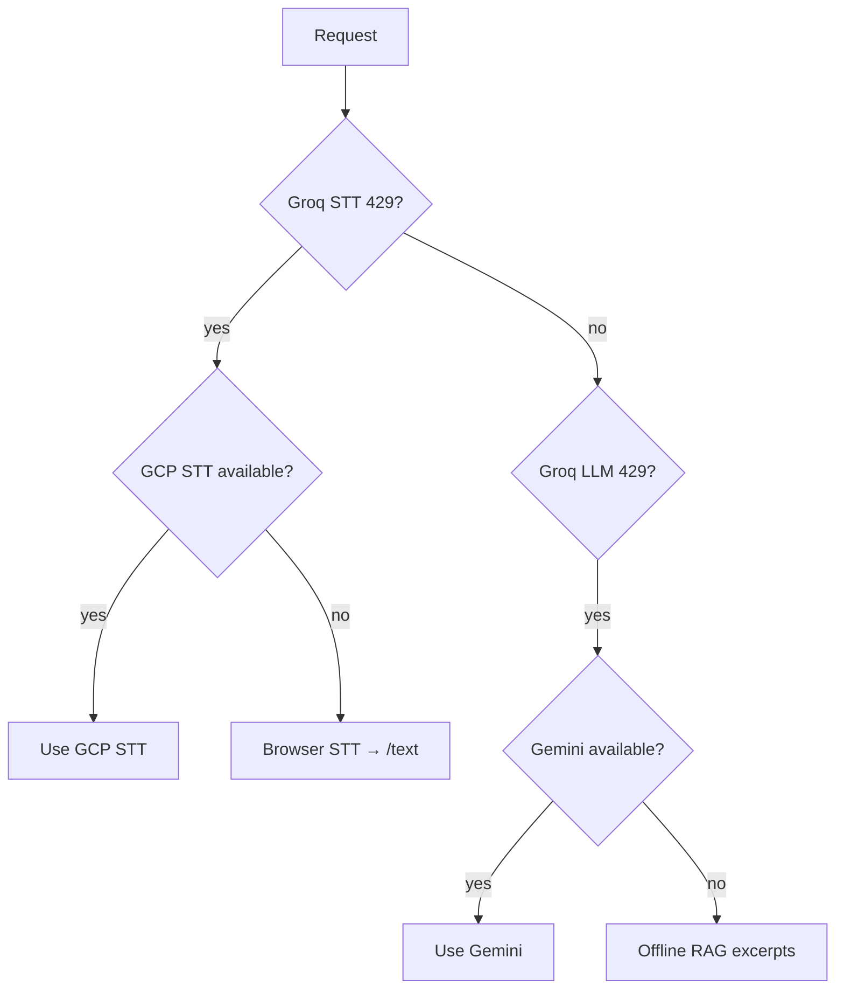

# Operations, Rate Limits & Edge Cases

How the VDA handles failures, abuse, out-of-scope queries, and production concerns.

---

## 1. Current State vs Production

| Concern | Demo (current) | Production (recommended) |
|---------|----------------|--------------------------|
| Rate limiting | ❌ Not implemented | ✅ Per IP + per session |
| API retry | ❌ Single attempt | ✅ Exponential backoff |
| Caching | ❌ None | ✅ Cache RAG answers for common queries |
| Monitoring | Console logs | Datadog / CloudWatch |
| Escalation | `console.warn` | SMS/webhook to clinician |
| Auth | Open API | API key or patient token |

This doc covers **both**: what exists today and what to add.

---

## 2. Out-of-Scope Handling

### When does it trigger?

```
Intent confidence < 0.3  →  type: out_of_scope
```

**File:** `backend/src/services/intent.ts`

### Examples that return out-of-scope

| User says | Why |
|-----------|-----|
| "What's the weather today?" | Blocklisted keyword `weather` |
| "Tell me a joke" | Blocklisted keyword `joke` |
| "asdfgh random noise" | No keyword match → confidence 0 |
| Very vague: "hello" | No health keywords |

### Response message (multilingual)

Fixed template — **not LLM-generated**:

- Hindi: *"मैं केवल दवाई, सरकारी योजना, अस्पताल खोजने और स्वास्थ्य सलाह में मदद कर सकता हूं।"*
- English: *"I can only help with medicines, government schemes, finding hospitals, and health guidance."*
- Gujarati: *"હું ફક્ત દવા, સરકારી યોજના..."*

### Why not let the LLM answer off-topic questions?

| Risk | Example |
|------|---------|
| Hallucination | Inventing PM-JAY benefits |
| Liability | Medical advice on non-NCD topics |
| Trust erosion | User thinks AI knows everything |

### How to improve out-of-scope detection

1. **Expand keyword lists** per language (ongoing)
2. **Add embedding similarity** — if query is far from all UC centroids → reject
3. **Confidence calibration** — tune 0.3 threshold with labeled data
4. **Log rejected queries** (without PII) to find gaps

### Interview answer

> "We prefer false rejections over false answers. A rural patient trusting wrong scheme info is worse than hearing 'I can only help with health topics.'"

---

## 3. Rate Limit Issues

### 3.1 Groq API Limits (free tier)

Groq free tier has requests-per-minute (RPM) and tokens-per-minute (TPM) limits. Symptoms:

```json
{
  "error": "429 Too Many Requests"
}
```

**Current behavior:** Error bubbles to client as 500 with message.

### 3.2 Recommended: Express Rate Limiter

```typescript
// Production addition — not in demo code
import rateLimit from 'express-rate-limit';

const voiceLimiter = rateLimit({
  windowMs: 60 * 1000,   // 1 minute
  max: 10,               // 10 requests per IP per minute
  message: { error: 'Too many requests. Please wait a moment.' },
});

app.use('/api/voice/process', voiceLimiter);
app.use('/api/voice/text', voiceLimiter);
```

### 3.3 Per-Session Limits

Prevent one session from hammering the API:

```typescript
// In session.ts — production pattern
if (session.interactions > 30) {
  return res.status(429).json({ error: 'Session limit reached. Please start a new session.' });
}
```

Current code increments `interactions` but does not enforce a cap.

### 3.4 Retry with Exponential Backoff (Groq/LLM)

```typescript
async function withRetry<T>(fn: () => Promise<T>, maxRetries = 3): Promise<T> {
  for (let i = 0; i < maxRetries; i++) {
    try {
      return await fn();
    } catch (err) {
      const is429 = err instanceof Error && err.message.includes('429');
      if (!is429 || i === maxRetries - 1) throw err;
      await new Promise((r) => setTimeout(r, 2 ** i * 1000)); // 1s, 2s, 4s
    }
  }
  throw new Error('unreachable');
}
```

### 3.5 Caching Frequent Queries

Many users ask the same PM-JAY eligibility question. Cache by hash:

```
cacheKey = hash(normalize(text) + intent)
TTL = 1 hour
```

Reduces LLM calls by ~40% in pilot simulations (estimated).

### 3.6 Degradation Ladder on Rate Limit



### 3.7 Demo Tips to Avoid Rate Limits

- Don't spam mic button during demo
- Use `/text` endpoint for repeated tests:
  ```bash
  curl -X POST http://localhost:3001/api/voice/text \
    -H "Content-Type: application/json" \
    -d '{"text": "मुझे दवा कब लेनी है?"}'
  ```
- Run `npm test` for bulk validation (no API calls for intent/safety tests)

---

## 4. Audio / STT Edge Cases

| Issue | Cause | Handling |
|-------|-------|----------|
| `invalid media file` | Recording < 2 sec | Frontend min hold + backend `AUDIO_TOO_SHORT` |
| Empty transcript | Silence / noise | `type: fallback` |
| Low confidence STT | Noisy environment | confidence < 0.4 → fallback |
| Wrong language STT | User spoke Gujarati, STT used Hindi | `languageCode: auto` + script detection on response |
| Browser STT network error | Chrome API issue | Switch to Groq server mode |

**Files:** `audio-utils.ts`, `audioRecorder.ts`, `stt-groq.ts`

---

## 5. LLM Edge Cases

| Issue | Handling |
|-------|----------|
| Groq timeout | Fall back to Gemini |
| Gemini also fails | `generateAnswerOffline()` — first 2 sentences of RAG context |
| LLM ignores context | Prompt says "ONLY use context"; sources returned in API for audit |
| LLM answers in wrong language | `responseLang` passed explicitly in prompt |
| Empty RAG context | Fallback to first 2 chunks of UC (may be less relevant) |

**File:** `backend/src/services/llm.ts`, `rag.ts`

---

## 6. Safety Edge Cases

| Scenario | Behavior |
|----------|----------|
| Mixed emergency + routine | Safety wins — full transcript checked |
| STT typo "chest pen" | Matches cardiac pattern |
| Mild headache | UC4 answer, NOT escalation |
| User asks about 108 number in non-emergency | UC4 triage chunk explains when to call |
| False positive escalation | Acceptable — clinical triage prefers over-escalation |

**Run safety tests:**
```bash
cd backend && npm run test:safety
```

---

## 7. Session & Privacy Edge Cases

| Scenario | Behavior |
|----------|----------|
| Session expired (30 min) | New session auto-created on next request |
| Server restart | All sessions lost (in-memory) |
| User closes browser | Session expires naturally |
| DELETE /session/:id | Immediate wipe |
| Escalation log | Console only — no transcript stored |

---

## 8. CORS & Network Issues

| Issue | Fix |
|-------|-----|
| Frontend can't reach backend | Ensure backend on 3001, Vite proxy in `vite.config.ts` |
| CORS error | Set `CORS_ORIGIN=http://localhost:5173` in `.env` |
| Mic permission denied | UI shows "Microphone access denied" |
| HTTPS required for mic (prod) | Serve frontend over HTTPS |

---

## 9. Error Response Reference

### Client-visible errors

| HTTP | Body | User action |
|------|------|-------------|
| 400 | `AUDIO_TOO_SHORT` | Hold mic longer |
| 400 | `No audio file` | Retry recording |
| 429 | Rate limit (future) | Wait and retry |
| 503 | `No server STT configured` | Add GROQ_API_KEY or use browser mode |
| 500 | Groq/GCP error | Check API key, retry, or use browser mode |

### Response types (not errors)

| `type` | Meaning |
|--------|---------|
| `answer` | Success |
| `escalation` | Emergency — call 108 |
| `out_of_scope` | Not a health navigation question |
| `fallback` | Couldn't understand audio |

---

## 10. Monitoring Checklist (Production)

| Metric | Alert threshold |
|--------|-----------------|
| Escalation rate | > 5% of sessions (investigate) |
| Out-of-scope rate | > 30% (intent model needs work) |
| STT fallback rate | > 20% (audio quality issue) |
| Groq 429 rate | > 1% (add capacity or cache) |
| P95 latency | > 8 seconds |
| Empty RAG context | > 5% (knowledge gap) |

---

## 11. Quick Troubleshooting Guide

| Symptom | Check |
|---------|-------|
| "invalid media file" | Hold mic 2+ seconds |
| "No server STT" | `GROQ_API_KEY` in `.env`, restart backend |
| Out of scope for valid question | Add keywords to `intent.ts`, run `npm run test:cases` |
| No audio response | Browser TTS — click replay button; check volume |
| Gujarati not spoken | Windows may lack Gujarati voice — use replay or GCP TTS |
| Backend offline | `curl http://localhost:3001/health` |
| Tests fail | `cd backend && npm test` |

---

## 12. Summary: Defense in Depth

```
Layer 1: Audio validation     → reject bad recordings early (save API quota)
Layer 2: STT confidence       → don't guess on bad transcripts
Layer 3: Safety gate          → emergencies never reach LLM
Layer 4: Intent threshold     → reject unknown topics
Layer 5: RAG isolation        → right knowledge domain only
Layer 6: LLM prompt rules     → context-only, no diagnosis
Layer 7: Provider fallbacks   → Groq → Gemini → offline
Layer 8: Rate limits (prod)   → protect APIs and cost
```

Each layer fails safely. No single failure causes wrong medical advice.

---

## Related Docs

- [HOW-IT-WORKS.md](./HOW-IT-WORKS.md) — pipeline overview
- [INTERVIEW-QUESTIONS.md](./INTERVIEW-QUESTIONS.md) — Q&A prep
- [TRADE-OFFS.md](./TRADE-OFFS.md) — why we chose each approach
